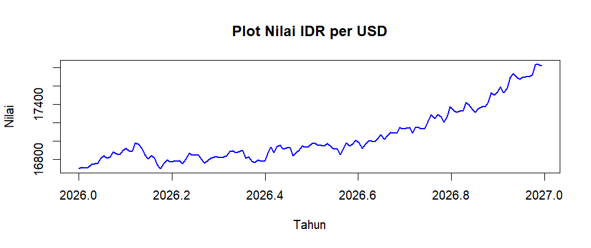
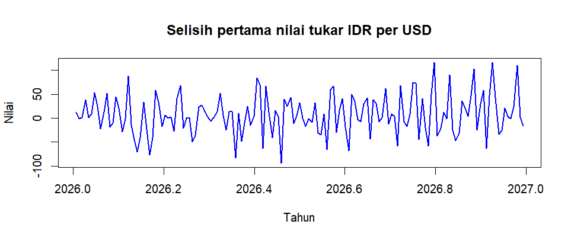
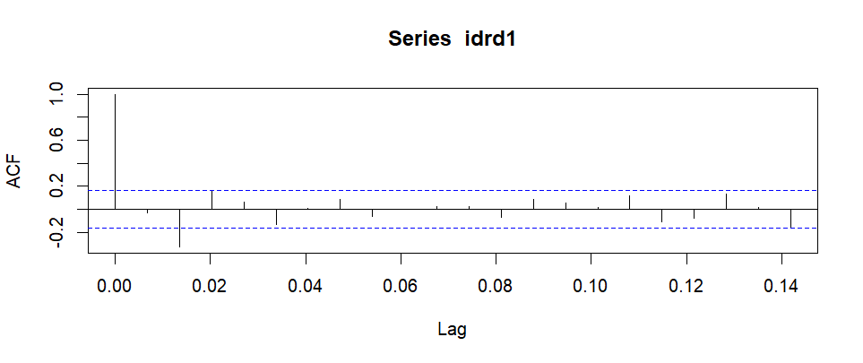
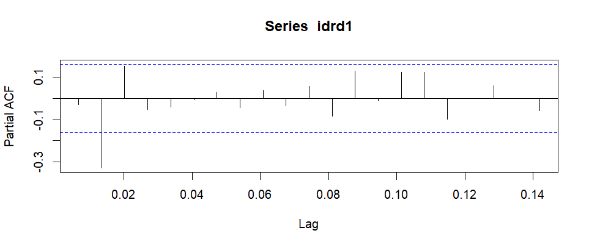
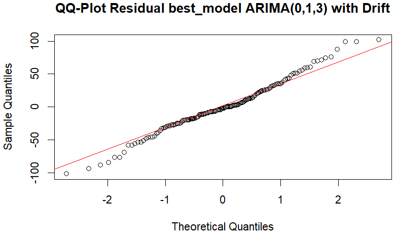
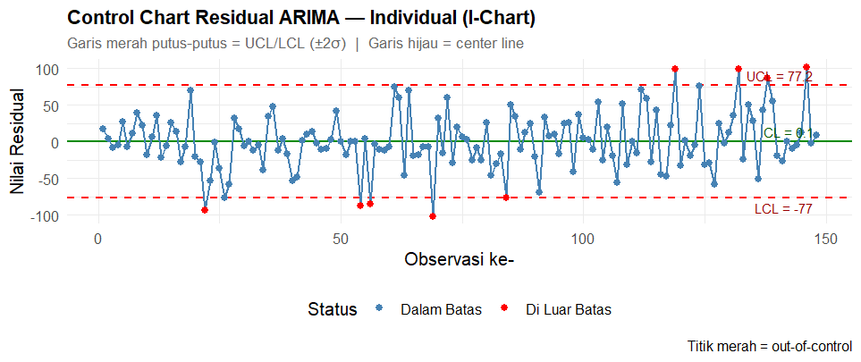
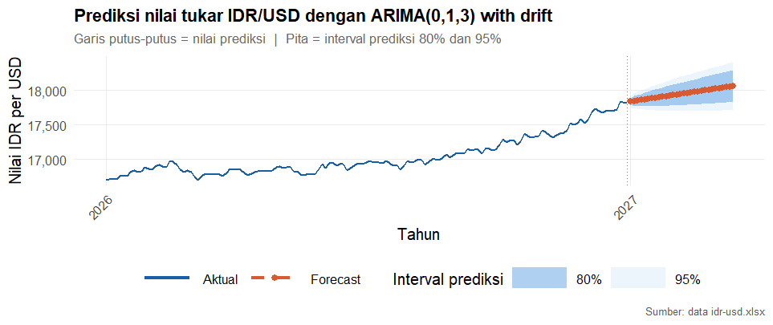
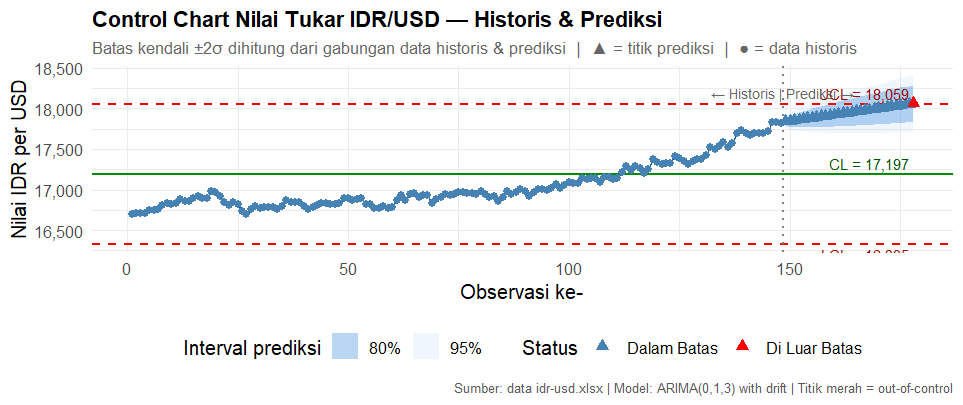

# Deteksi Anomali Deret Waktu Nilai Tukar IDR/USD

[English](README.md) · **Bahasa Indonesia**

Proyek ini menggunakan **ARIMA(0,1,3) dengan drift** untuk meramalkan kurs rupiah terhadap dolar AS dan **peta kendali individu (I-chart)** untuk menandai galat model yang besar. Dari 148 observasi historis, peta kendali menandai **9 residual**. Ramalan pada langkah ke-30 mencapai **Rp18.063,28 per USD**, dengan interval prediksi 95% sebesar **Rp17.713,72–18.412,84**.

## Data dan stasioneritas

Data memuat 148 kurs harian dari Xe, mencakup 1 Januari hingga 28 Mei 2026. Kolom `IDR` menyatakan jumlah rupiah per dolar AS. Kenaikan angka ini menunjukkan pelemahan rupiah terhadap dolar AS. Kurs berkisar dari **Rp16.699,50** hingga **Rp17.834,75**, dengan rata-rata **Rp17.044,01** dan median **Rp16.940,29**. Kenaikan kurs terlihat lebih tajam menjelang akhir periode pengamatan. [Tabel kurs Xe](https://www.xe.com/currencytables/) · [Berkas data kurs](idr-usd.xlsx)



Estimasi Box–Cox menghasilkan λ = 1, sehingga skrip menggunakan skala asli. Uji Augmented Dickey–Fuller (ADF) menggunakan lag 5. Tren kenaikan yang terlihat pada deret awal hilang setelah diferensiasi pertama, dan hasil uji ADF mendukung penggunaan `d = 1`.

| Deret | Statistik ADF | Nilai p | Keputusan pada taraf 5% |
| --- | ---: | ---: | --- |
| Level kurs | 0,10444 | > 0,99 | Gagal menolak hipotesis akar unit |
| Selisih pertama | −5,7259 | < 0,01 | Menolak hipotesis akar unit |



## Identifikasi dan kecocokan model

ACF dan PACF dari deret selisih pertama sama-sama menunjukkan lonjakan negatif yang jelas pada lag ke-2. Kedua grafik membantu menentukan orde model yang akan diuji. R menyesuaikan skala sumbu lag dengan frekuensi objek `ts`, sehingga lag ke-2 terlihat pada sekitar 0,0135.





Skrip R membandingkan sembilan model yang ditentukan secara manual dengan model hasil `forecast::auto.arima(idr, d = 1)`. Dengan pengaturan bawaan, pencarian otomatis menggunakan AICc. ARIMA(0,1,3) dengan drift yang dihasilkan juga memiliki AIC dan BIC terendah di antara sepuluh model yang dibandingkan. AIC terendah berikutnya adalah **1.505,880** untuk ARIMA(2,1,1). [Skrip R](time_series_anomaly_detection.R) · [Dokumentasi paket forecast](https://pkg.robjhyndman.com/forecast/reference/auto.arima.html)

| Kriteria model | Nilai | Galat dalam sampel | Nilai |
| --- | ---: | --- | ---: |
| AIC | 1.500,882 | RMSE | 38,41 IDR/USD |
| AICc | 1.501,31 | MAE | 28,99 IDR/USD |
| BIC | 1.515,834 | MAPE | 0,1698% |

| Parameter | Estimasi | Nilai p |
| --- | ---: | ---: |
| MA(1) | 0,014888 | 0,855222 |
| MA(2) | −0,328209 | 0,00003726 |
| MA(3) | 0,137293 | 0,131178 |
| Drift | 7,702000 | 0,003325 |

Drift menunjukkan kecenderungan kenaikan kurs sekitar **Rp7,70 per observasi**. Koefisien MA(2) yang negatif berarti kejutan positif dua observasi sebelumnya memberi kontribusi negatif pada perubahan kurs saat ini. Drift dan MA(2) masing-masing signifikan pada taraf 5%. Ukuran galat menggambarkan kecocokan model pada data historis. Akurasi pada observasi baru belum diukur.

## Diagnostik residual

| Uji Ljung–Box | Nilai p lag 6 | Nilai p lag 12 | Nilai p lag 24 |
| --- | ---: | ---: | ---: |
| Residual | 0,9164 | 0,9485 | 0,9016 |
| Kuadrat residual | 0,8117 | 0,1264 | 0,2148 |

Uji Ljung–Box menggunakan `fitdf = 0`. Hasilnya tidak menunjukkan autokorelasi yang signifikan pada lag yang diuji, baik pada residual maupun kuadrat residual. Bagian tengah grafik Q–Q dari makalah mengikuti garis acuan, dengan penyimpangan pada kedua ekor. Hasil Kolmogorov–Smirnov (`D = 0,07335`, nilai `p` nominal `0,4034`) bersifat deskriptif karena rata-rata dan simpangan baku diestimasi dari residual yang sama. [Dokumentasi Ljung–Box di R](https://stat.ethz.ch/R-manual/R-devel/library/stats/html/box.test.html) · [Dokumentasi Kolmogorov–Smirnov di R](https://stat.ethz.ch/R-manual/R-devel/library/stats/html/ks.test.html)



## Peta kendali residual

Garis tengah I-chart adalah rata-rata residual, yaitu selisih antara nilai aktual dan taksiran model. Batas kendali ditetapkan dua simpangan baku sampel dari garis tengah. Garis tengah berada pada **0,1175**, dengan **batas bawah −76,9612** dan **batas atas 77,1962**, dalam satuan IDR per USD. Lima residual berada di bawah batas bawah dan empat di atas batas atas.



| Observasi | Tanggal dalam data | Residual (IDR/USD) | Batas yang dilampaui |
| ---: | --- | ---: | --- |
| 22 | 2026-01-22 | −93,82 | Bawah |
| 54 | 2026-02-23 | −88,11 | Bawah |
| 56 | 2026-02-25 | −84,86 | Bawah |
| 69 | 2026-03-10 | −101,80 | Bawah |
| 84 | 2026-03-25 | −76,98 | Bawah |
| 119 | 2026-04-29 | +99,19 | Atas |
| 132 | 2026-05-12 | +99,24 | Atas |
| 138 | 2026-05-18 | +87,41 | Atas |
| 146 | 2026-05-26 | +101,77 | Atas |

Sinyal positif menunjukkan rupiah lebih lemah daripada taksiran model. Sinyal negatif menunjukkan rupiah lebih kuat. Sebagai acuan, galat independen yang berdistribusi normal memiliki peluang sekitar 4,55% per observasi untuk berada di luar batas tetap ±2σ, atau sekitar 7 kali dalam 148 observasi. Sembilan titik di luar batas menunjukkan galat yang perlu ditelaah. Mengaitkannya dengan peristiwa pasar tertentu memerlukan bukti terpisah.

## Peramalan 30 langkah

Kurs historis terakhir adalah **Rp17.819,29 per USD**. Ramalan titik naik dari **Rp17.841,88** pada langkah pertama dan mulai melampaui **Rp18.000** pada langkah ke-22. Interval prediksi 80% dan 95% melebar seiring bertambahnya horizon. Pada langkah ke-30, kedua interval masih mencakup Rp18.000 meski ramalan titik berada di atasnya.

| Langkah | Ramalan titik | Interval prediksi 80% | Interval prediksi 95% |
| ---: | ---: | ---: | ---: |
| 1 | 17.841,88 | 17.791,80–17.891,96 | 17.765,30–17.918,47 |
| 22 | 18.001,66 | 17.805,14–18.198,18 | 17.701,11–18.302,22 |
| 30 | 18.063,28 | 17.834,72–18.291,84 | 17.713,72–18.412,84 |



Angka peramalan diambil dari tabel keluaran R. Bagian 3.8 makalah mencantumkan angka berbeda untuk langkah ke-30, yaitu Rp18.050,35. Label `2027` berasal dari `ts(..., start = c(2026, 1), frequency = 148)`, yang menaikkan indeks tahun setelah 148 observasi. Langkah peramalan dihitung dari catatan terakhir dalam data.

### Level kurs historis dan hasil peramalan

Grafik level kurs berikut menggabungkan **148 kurs historis dan 30 ramalan titik**. Batas bawah, garis tengah, dan batas atas setelah pembulatan masing-masing adalah **Rp16.335**, **Rp17.197**, dan **Rp18.059** per USD. Seluruh kurs historis berada di dalam batas gabungan. Segitiga merah menandai langkah ke-30, satu-satunya ramalan titik di atas batas atas. Batas gabungan bersifat deskriptif karena perhitungannya memakai hasil ramalan. Pita berwarna menunjukkan ketidakpastian prediksi model di tiap langkah.



## Menjalankan analisis

Buka R atau RStudio dan gunakan folder utama repositori sebagai direktori kerja agar skrip dapat menemukan `idr-usd.xlsx`. Instal paket sekali, lalu jalankan skrip.

```r
install.packages(c(
  "ggfortify", "forecast", "tseries", "Metrics", "lmtest", "fpp2",
  "ggplot2", "readxl", "tidyr", "openxlsx", "scales", "qcc"
))
source("time_series_anomaly_detection.R", echo = TRUE)
```

Tabel ramalan tersedia di `df_fc`, data peta kendali residual di `df_res_cc`, serta data grafik level kurs historis dan ramalan di `df_hist_cc` dan `df_fc_cc`.

## Sumber

Analisis mengikuti makalah *Deteksi Sinyal Out-of-Control pada Peramalan Nilai Tukar Melalui Pendekatan ARIMA-Control Chart*. Hasil numerik menggunakan keluaran konsol R dan data kurs di repositori. Grafik mempertahankan label asli dalam bahasa Indonesia.
