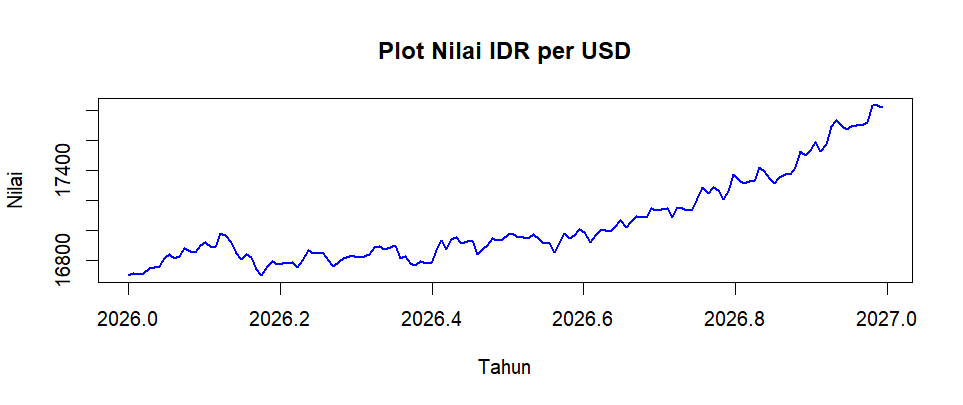
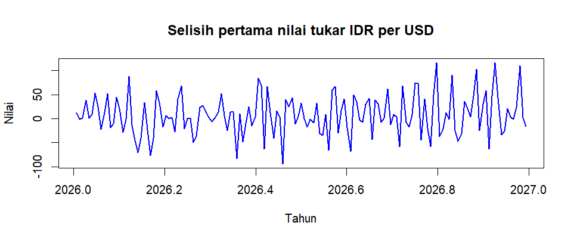
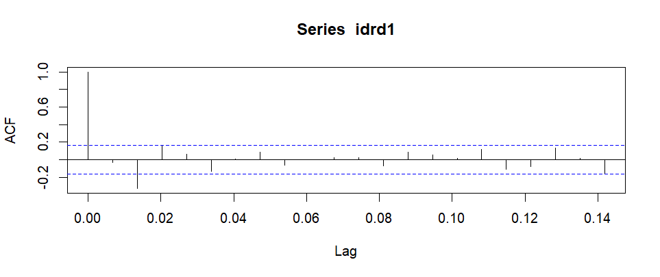
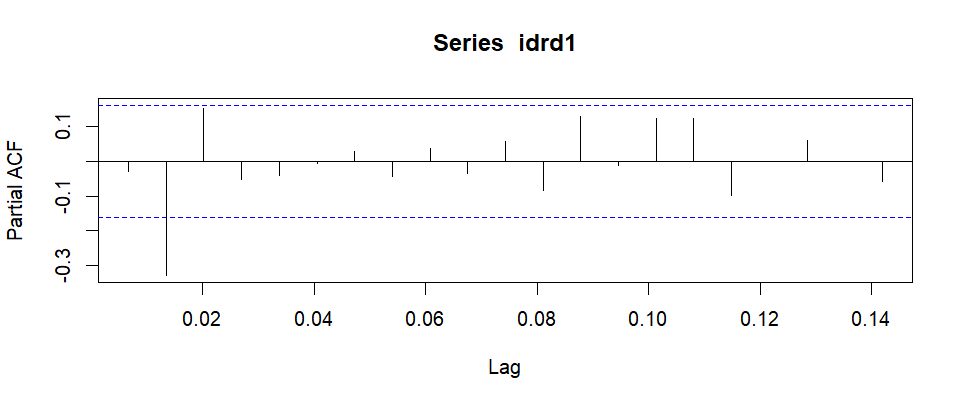
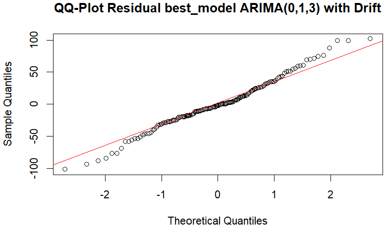
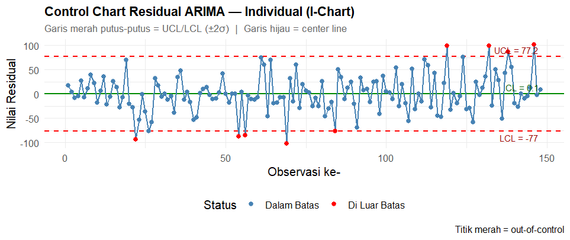
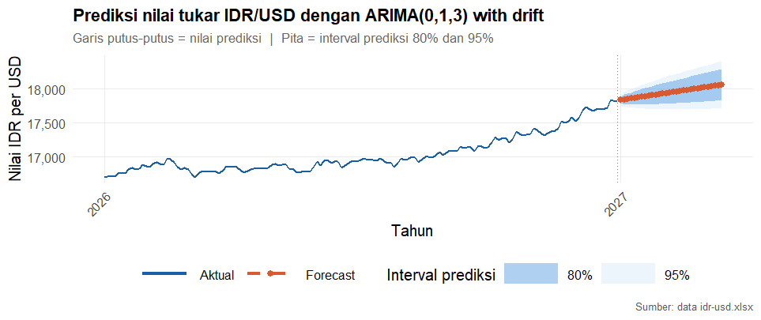
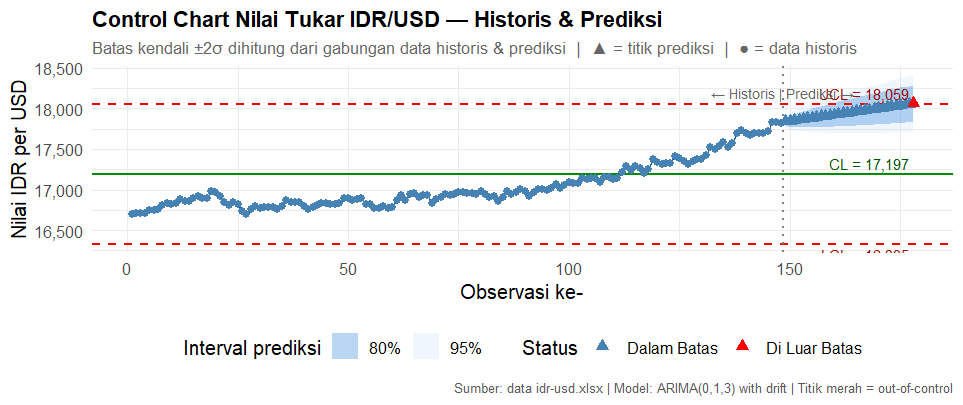

# Time Series Anomaly Detection for IDR/USD

**English** · [Bahasa Indonesia](README.id.md)

This project uses **ARIMA(0,1,3) with drift** to forecast the rupiah–dollar exchange rate and an **Individuals control chart (I-chart)** to flag unusually large model errors. Across 148 historical observations, the residual chart flagged **9 points**. The 30-step forecast rises to **Rp18,063.28 per USD**, with a step-30 95% prediction interval of **Rp17,713.72–18,412.84**.

## Data and stationarity

The workbook contains 148 daily exchange rates from Xe, covering January 1 to May 28, 2026. The `IDR` column is the number of rupiah per US dollar, so an increase indicates a weaker rupiah against the dollar. Rates in the workbook range from **Rp16,699.50** to **Rp17,834.75**, with a mean of **Rp17,044.01** and a median of **Rp16,940.29**. The series rises more sharply toward the end of the sample. [Xe Currency Tables](https://www.xe.com/currencytables/) · [Input workbook](idr-usd.xlsx)



The Box–Cox estimate was λ = 1, so the script retained the original scale. The Augmented Dickey–Fuller (ADF) tests used lag 5. The first difference removes the visible upward trend, and the ADF result supports using one difference (`d = 1`).

| Series | ADF statistic | p-value | Decision at 5% |
| --- | ---: | ---: | --- |
| Exchange-rate levels | 0.10444 | > 0.99 | Fail to reject a unit root |
| First differences | −5.7259 | < 0.01 | Reject a unit root |



## Model identification and fit

The ACF and PACF of the differenced series both show a pronounced negative spike at lag 2. The plots guide the choice of candidate orders. R scales the lag axis by the `ts` frequency, so lag 2 appears at approximately 0.0135 on these plots.





The [R script](time_series_anomaly_detection.R) compares nine manually specified models with the model returned by `forecast::auto.arima(idr, d = 1)`. The automatic search uses AICc by default. The returned ARIMA(0,1,3) with drift also had the lowest AIC and BIC among the ten reported fits. The next-lowest AIC was **1505.880** for ARIMA(2,1,1). [forecast package documentation](https://pkg.robjhyndman.com/forecast/reference/auto.arima.html)

| Model fit | Value | In-sample error | Value |
| --- | ---: | --- | ---: |
| AIC | 1500.882 | RMSE | 38.41 IDR/USD |
| AICc | 1501.31 | MAE | 28.99 IDR/USD |
| BIC | 1515.834 | MAPE | 0.1698% |

| Term | Estimate | p-value |
| --- | ---: | ---: |
| MA(1) | 0.014888 | 0.855222 |
| MA(2) | −0.328209 | 0.00003726 |
| MA(3) | 0.137293 | 0.131178 |
| Drift | 7.702000 | 0.003325 |

The fitted drift corresponds to an underlying increase of about **Rp7.70 per observation** in the exchange rate. The negative MA(2) coefficient indicates that a positive model shock two observations earlier contributes in the opposite direction to the current change. The drift and MA(2) are individually significant at 5%. The error metrics describe the fit to the historical sample, and forecast accuracy on new observations remains unmeasured.

## Residual diagnostics

| Ljung–Box test | Lag 6 p-value | Lag 12 p-value | Lag 24 p-value |
| --- | ---: | ---: | ---: |
| Residuals | 0.9164 | 0.9485 | 0.9016 |
| Squared residuals | 0.8117 | 0.1264 | 0.2148 |

The reported tests used `fitdf = 0` and found no significant autocorrelation at the tested lags in either the residuals or their squares. The Q–Q plot from the paper follows the reference line through the middle, with departures in both tails. The reported Kolmogorov–Smirnov result (`D = 0.07335`, nominal `p = 0.4034`) is descriptive because the test used a mean and standard deviation estimated from the same residuals. [R Ljung–Box documentation](https://stat.ethz.ch/R-manual/R-devel/library/stats/html/box.test.html) · [R Kolmogorov–Smirnov documentation](https://stat.ethz.ch/R-manual/R-devel/library/stats/html/ks.test.html)



## Residual control chart

The I-chart centers on the mean residual (actual minus fitted) and uses limits two sample standard deviations from that mean. Its center line is **0.1175**, with a **lower limit of −76.9612** and an **upper limit of 77.1962**, all in IDR per USD. Five residuals fall below the lower limit and four rise above the upper limit.



| Observation | Workbook date | Residual (IDR/USD) | Limit crossed |
| ---: | --- | ---: | --- |
| 22 | 2026-01-22 | −93.82 | Lower |
| 54 | 2026-02-23 | −88.11 | Lower |
| 56 | 2026-02-25 | −84.86 | Lower |
| 69 | 2026-03-10 | −101.80 | Lower |
| 84 | 2026-03-25 | −76.98 | Lower |
| 119 | 2026-04-29 | +99.19 | Upper |
| 132 | 2026-05-12 | +99.24 | Upper |
| 138 | 2026-05-18 | +87.41 | Upper |
| 146 | 2026-05-26 | +101.77 | Upper |

A positive flag means the rupiah was weaker than the fitted rate implied. A negative flag means it was stronger. For reference, independent normal errors would exceed fixed ±2σ limits about 4.55% of the time, or roughly 7 times in 148 observations. The nine crossings identify errors to investigate. Attributing any of them to a market event would require separate evidence.

## 30-step forecast

The last historical rate was **Rp17,819.29 per USD**. The point forecast rises from **Rp17,841.88** at step 1 and first exceeds **Rp18,000** at step 22. The 80% and 95% prediction bands widen with the horizon. By step 30, both bands span Rp18,000 even though the point forecast is above it.

| Step | Point forecast | 80% prediction interval | 95% prediction interval |
| ---: | ---: | ---: | ---: |
| 1 | 17,841.88 | 17,791.80–17,891.96 | 17,765.30–17,918.47 |
| 22 | 18,001.66 | 17,805.14–18,198.18 | 17,701.11–18,302.22 |
| 30 | 18,063.28 | 17,834.72–18,291.84 | 17,713.72–18,412.84 |



The forecast values come from the printed R table. Section 3.8 of the paper gives a different step-30 estimate of Rp18,050.35. The `2027` tick comes from `ts(..., start = c(2026, 1), frequency = 148)`, which advances its year index after 148 observations. Forecast steps are relative to the last record in the workbook.

### Historical and forecast levels

The level chart below pools the **148 historical rates and 30 forecast means**. Its rounded lower, center and upper lines are **Rp16,335**, **Rp17,197** and **Rp18,059** per USD. All historical rates are inside the pooled limits. The red triangle marks step 30, the only point forecast above the upper line. The pooled limits are descriptive because they depend on the forecasts themselves. The shaded bands show the model's prediction uncertainty at each step.



## Run the analysis

Open R or RStudio with the repository root as your working directory so the script can find `idr-usd.xlsx`. Install the packages once and run the script.

```r
install.packages(c(
  "ggfortify", "forecast", "tseries", "Metrics", "lmtest", "fpp2",
  "ggplot2", "readxl", "tidyr", "openxlsx", "scales", "qcc"
))
source("time_series_anomaly_detection.R", echo = TRUE)
```

The forecast table is available as `df_fc`, the residual chart data as `df_res_cc`, and the historical and forecast level chart data as `df_hist_cc` and `df_fc_cc`.

## Sources

The analysis follows the supplied manuscript *Deteksi Sinyal Out-of-Control pada Peramalan Nilai Tukar Melalui Pendekatan ARIMA-Control Chart*. The numerical results use the accompanying R console output and the repository's workbook. The figures retain the original Indonesian labels.
